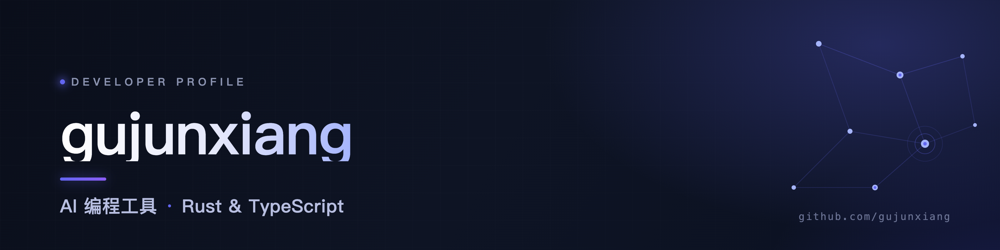

  

<h3 align="center">你好，我是 gujunxiang 👋</h3>

  <em>专注 AI 编程工具与开发者工具 · Building AI coding tools &amp; developer tooling</em>

  用 <b>Rust</b> 和 <b>TypeScript</b> 构建自托管的 AI 助手、AI 编程编辑器与跨平台工具，偏好本地优先、隐私友好、可自托管的开发者体验。 
  I build self-hosted AI assistants, AI coding editors, and cross-platform tools — with a bias for local-first, privacy-friendly, self-hostable developer experience.

---

### 🧰 技术栈 · Tech Stack

  
  
  
  
  
  
  

### 📊 GitHub 统计 · Stats

  

  

  

### 🚀 精选项目 · Featured Projects

| 项目 Project | 简介 | 链接 |
| :--- | :--- | :--- |
| **VelaTerm** | Codex + iTerm2，面向 AI 编程的现代化 ADE | [仓库](https://github.com/gujunxiang/VelaTerm) · [velaterm.com](https://velaterm.com) |
| **grok-build-Chinese** | Grok Build 非官方简体中文社区版 · 去遥测 / 中文界面 | [仓库](https://github.com/gujunxiang/grok-build-Chinese) |
| **kiro.rs** | 用 Rust 编写的 Kiro 客户端 | [仓库](https://github.com/gujunxiang/kiro.rs) |

### 📬 联系我 · Contact

  
  
  

感谢访问 · Thanks for stopping by ✦

